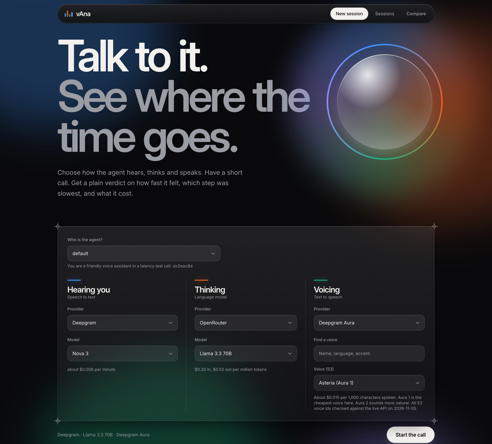
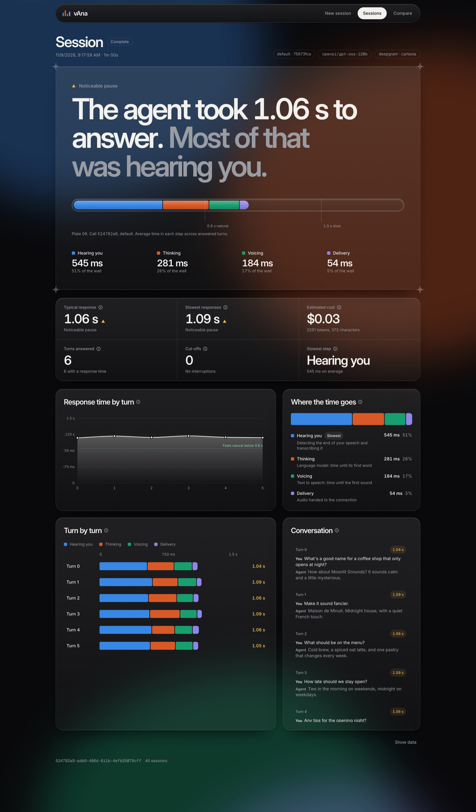
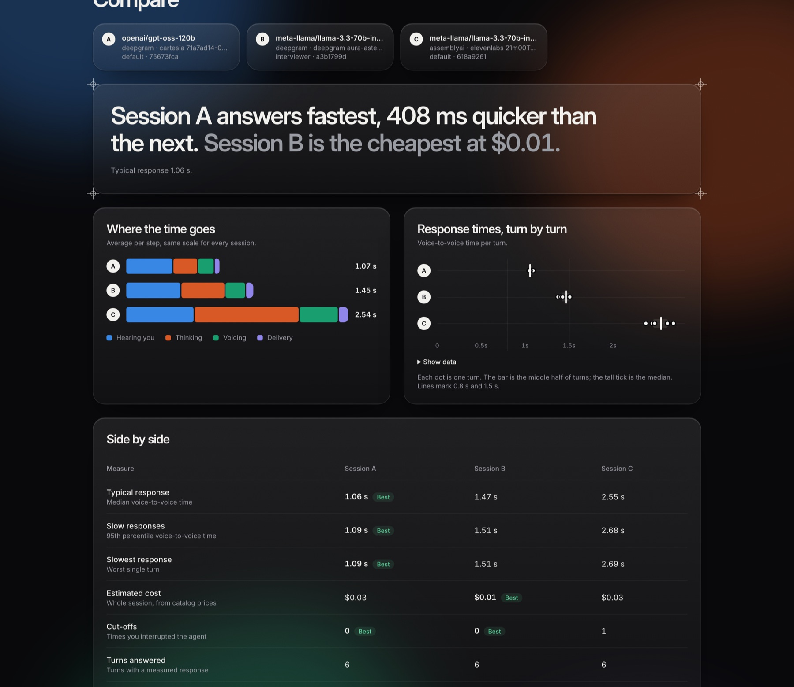
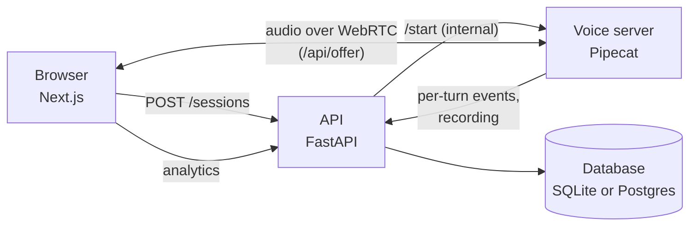

# vAna

**Voice session analytics.** Talk to a voice agent, end the call, then see where each turn spent its time: hearing you, thinking, voicing, or delivery. Compare stacks side by side and see what each call cost.

<!-- Demo video: drag brag.mp4 into this file on github.com to get a hosted link, then paste it here. -->



## What it does

A voice agent pauses before it answers. vAna turns that pause into numbers you can act on.

- **Choose the stack.** Pick the speech-to-text, language model and voice for each call, and the persona (the system prompt). Providers, models, voices and prices live in one catalog, `config/providers.yaml`.
- **Have a short call.** The browser talks to a [Pipecat](https://github.com/pipecat-ai/pipecat) voice server over WebRTC.
- **Get a plain verdict.** Every turn is split into four steps and shown as a waterfall:
  - **Hearing you:** detecting the end of your speech and transcribing it.
  - **Thinking:** the language model, time until its first word.
  - **Voicing:** text to speech, time until the first sound.
  - **Delivery:** audio handed to the connection.
- **Replay the call.** The recording plays back in sync with the transcript.
- **Compare.** Pick 2 to 4 sessions and read off which answers fastest and which costs least. The best value in each row is marked with a label.

| | |
|---|---|
|  |  |

The sessions in these screenshots are fictional sample data.

More screens: [session list](docs/images/sessions.jpg), [a slower session](docs/images/session-slow.jpg).

## How it works



- `apps/web`: the Next.js app (new session, live call, analytics, compare).
- `services/api`: FastAPI. Creates sessions, ingests timing events, derives turns and metrics, stores the recording.
- `services/voice`: the Pipecat pipeline for one call, plus the observer that timestamps each step.
- `config/providers.yaml`: the catalog of providers, models, voices and prices, read by the API and the voice server.

Metric definitions and the API, event and database contracts are in [`DESIGN.md`](DESIGN.md) (Part 2).

## Quickstart

You need Python 3.12, Node 20+, and API keys in `.env` (copy `.env.example`). The default stack uses Deepgram, OpenRouter and Cartesia. A provider becomes selectable once its key is set.

```bash
cp .env.example .env     # then add your keys. Never commit .env

# 1. API (SQLite by default; Postgres via infra/docker-compose.yml)
cd services/api && python3 -m venv .venv && .venv/bin/pip install -r requirements.txt
DATABASE_URL=sqlite+aiosqlite:////tmp/vana-dev.db .venv/bin/alembic upgrade head
DATABASE_URL=sqlite+aiosqlite:////tmp/vana-dev.db .venv/bin/uvicorn app.main:app --port 8000

# 2. Voice server (new terminal)
cd services/voice && python3 -m venv .venv && .venv/bin/pip install -r requirements.txt
.venv/bin/python server.py            # port 8100

# 3. Web (new terminal)
cd apps/web && npm install && npm run dev   # http://localhost:3000
```

Open http://localhost:3000, choose a stack, and start the call.

Tests: `cd services/api && .venv/bin/python -m pytest`, and the same in `services/voice`. Web lint: `cd apps/web && npm run lint`.

## Configuration

| Setting | What it does |
|---|---|
| `*_API_KEY` | One per provider. See `.env.example` for the list. |
| `DATABASE_URL` | SQLite by default. Use `infra/docker-compose.yml` for Postgres. |
| `VANA_INTERNAL_TOKEN` | Shared secret between the API and the voice server. Set it before exposing the app. |
| `VANA_MAX_CALL_S`, `VANA_IDLE_S`, `VANA_MAX_CONCURRENT`, `VANA_PENDING_TTL_S` | Cost guards on the voice server: call length (300), idle hang-up (60), concurrent calls (10), unconnected-session expiry (60). |
| `VANA_EXTENSIONS` | Optional extension modules (a request guard and events). Empty for the stock app. |
| `LANGFUSE_*` | Optional. Load personas from Langfuse instead of `services/voice/personas/*.md`. |

Recordings are stored on local disk (`data/audio`). `services/api/app/storage.py` is the one place to swap in S3 or MinIO.

## Adding a provider or voice

Everything selectable is in `config/providers.yaml`. A provider is one entry: its API key name (`env`), the Pipecat class that runs it (`service`), and its models or voices. No code change is needed for providers that use Pipecat's standard `api_key` plus `Settings(model=..., voice=...)` pattern. `services/voice/tests/test_providers.py` builds every entry, so a wrong class path fails the tests.

| Step | Providers |
|---|---|
| Speech to text | Deepgram, AssemblyAI, OpenAI, Groq Whisper, ElevenLabs Scribe, Cartesia Ink, Soniox, Gladia, Together AI |
| Voice | Deepgram Aura (53 voices), Groq Orpheus, OpenAI, Cartesia (full library, live), ElevenLabs (full library, live), xAI, Together AI, Smallest AI |

Tested with real calls: Deepgram, Groq Whisper, Cartesia (speech to text and voice), Deepgram Aura, Groq Orpheus. The rest build correctly but have not been run with a real key; expect to fix small details. Voice lists for Cartesia and ElevenLabs are fetched with your key (`GET /providers/tts/{provider}/voices`, cached for an hour). Providers marked `custom_voice` also accept any voice id typed by hand.

## Before you expose it to the internet

Local defaults are open on purpose. Before anyone else can reach the API or the voice server:

- Set `VANA_INTERNAL_TOKEN` (a long random value, same in the API and voice server environments). Without it, the voice server's `/start` and `/stop` and the API's event and audio-upload routes accept anyone, so a stranger could start calls on your provider keys.
- The voice server's `/api/offer` has to be public for browsers to connect. It only accepts a session that the API registered through `/start`.
- Add your own sign-in or rate limits in front (see the optional extension seams in `services/api/app/extensions.py`), and set spend limits in each provider's dashboard.
- The model and voice a caller picks are passed to the provider as given when the catalog allows a custom id (`custom_model`, `custom_voice`). Pin them if you host a public demo.
- The web app sets no security headers by default. Add a Content-Security-Policy and `X-Frame-Options` if you serve it publicly, since it asks for the microphone.

## Contributing and security

See [`CONTRIBUTING.md`](CONTRIBUTING.md). To report a vulnerability, follow [`SECURITY.md`](SECURITY.md).

## License

Apache License 2.0. See `LICENSE` and `NOTICE`.
